


 

<a href="https://www.instagram.com/chelokebab10k/"></a>
<a href="https://x.com/reezz47190"></a>

Self-taught developer who started with Python and fell hard for **React**. I build interfaces the way I lay out pages: type first, spacing second, motion last.

Outside the editor I make editorial-style graphics: a long-running character card series, designed in Figma, where every card carries one color pop and a detail you only catch on a second look.

> Clean layout. Clear hierarchy. Smooth interaction.


Everything new goes through React now. Components first, pages second, and every transition gets a say.

<a href="https://cheloarchive.my.id"></a>
<a href="https://github.com/Greeezzz/Waifu-Card"></a>
<a href="https://github.com/Greeezzz/Eri"></a>

  

<a href="https://www.instagram.com/chelokebab10k/"></a>

<b>Earlier experiments</b> (where it all started)

 

- [Neera](https://github.com/Greeezzz/Neera) &mdash; minimalist social media concept
- [Chatting_App](https://github.com/Greeezzz/Chatting_App) &mdash; chat with anyone
- [Aplikasi-Bankmini](https://github.com/Greeezzz/Aplikasi-Bankmini) &mdash; mini banking app
- [To-Do-List](https://github.com/Greeezzz/To-Do-List) &mdash; list what you want to get done
- [Tic-Tac-Toe](https://github.com/Greeezzz/Tic-Tac-Toe) &mdash; the classic
- [Biodata-html](https://github.com/Greeezzz/Biodata-html) &mdash; first page ever, built off a YouTube tutorial

&nbsp;&nbsp;→ &nbsp;[All repositories](https://github.com/Greeezzz?tab=repositories)




 

COLOPHON &mdash; SET IN MONOSPACE AND GEORGIA. EDITED DAILY. STILL IN PRODUCTION.

